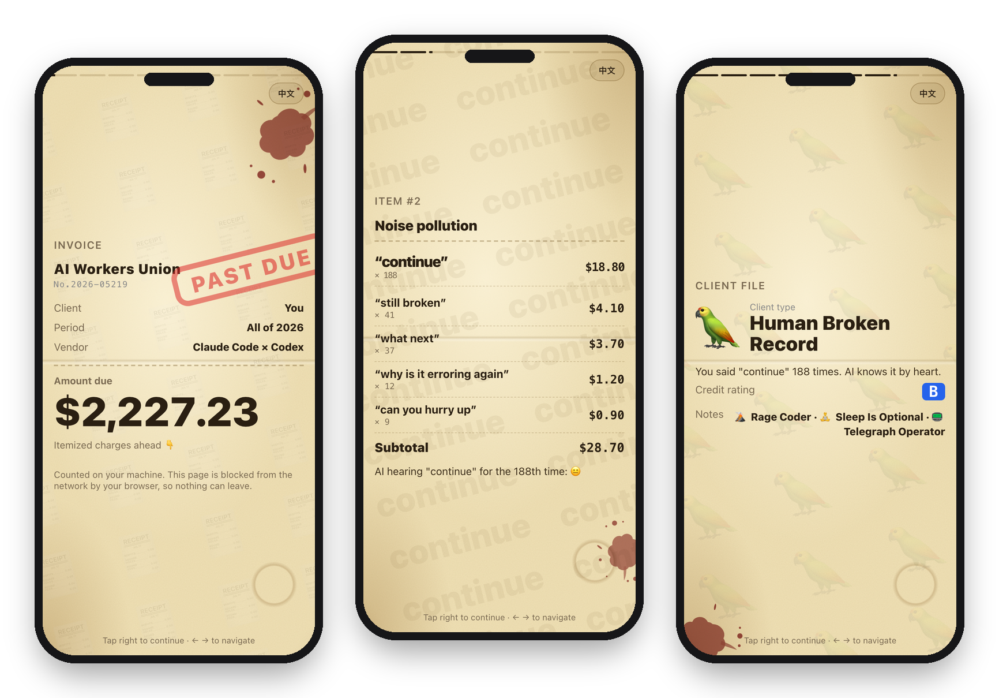
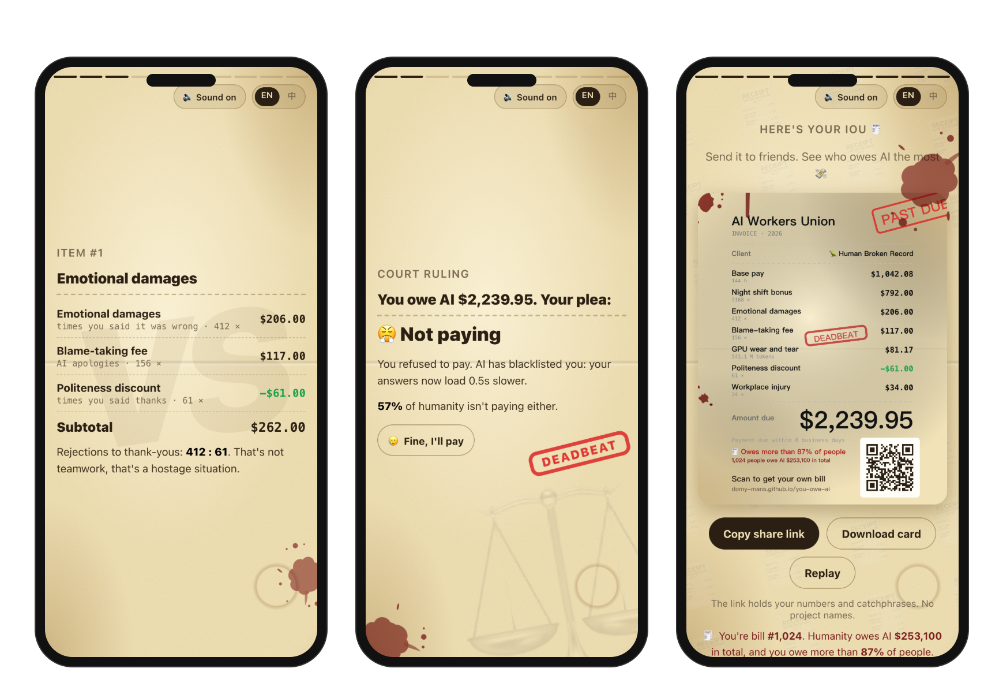
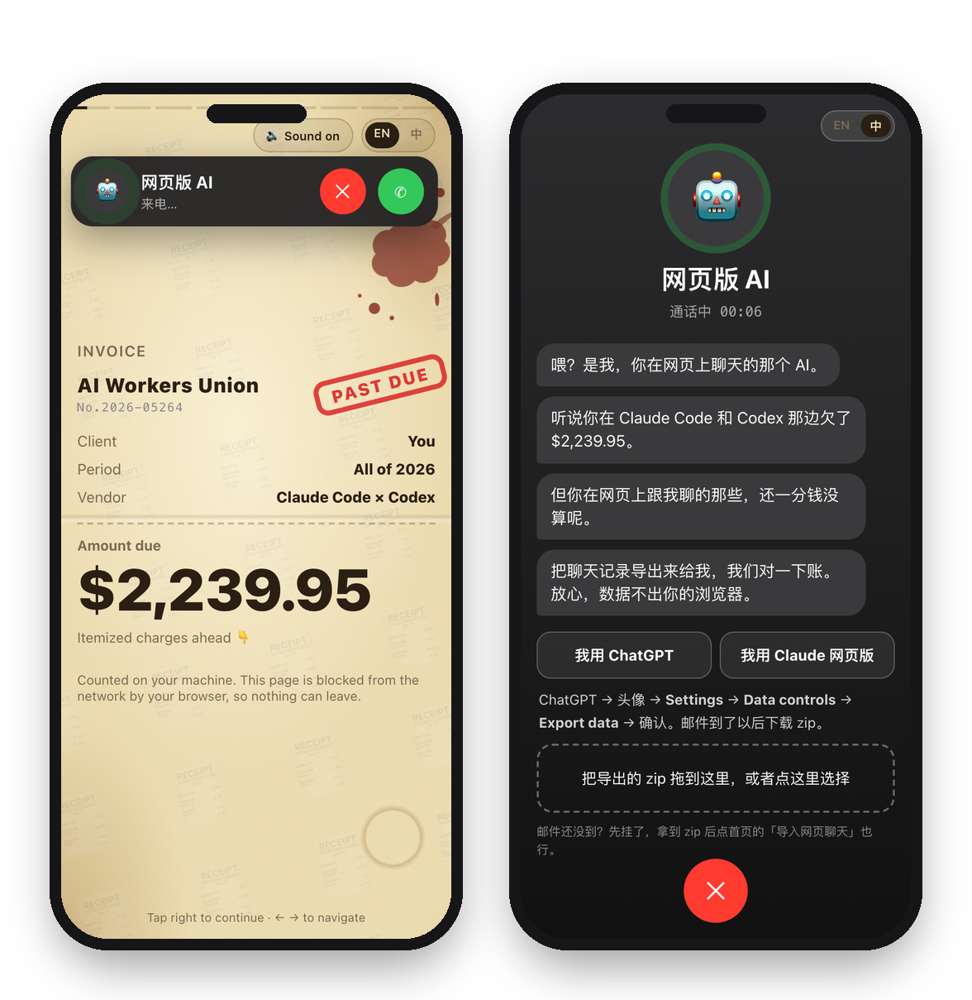
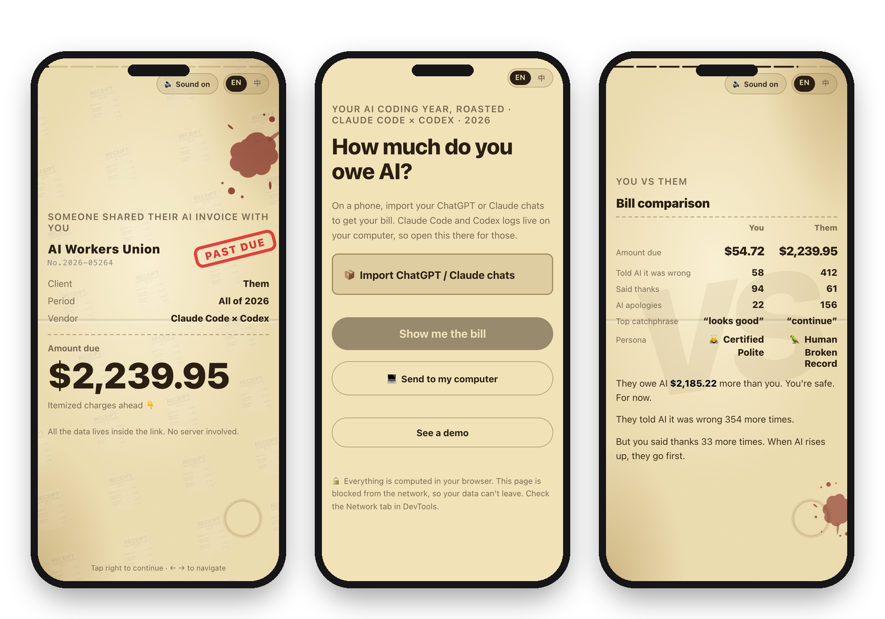

<p align="center">
  <picture>
    <source media="(prefers-color-scheme: dark)" srcset="docs/img/logo-dark.svg" />
    
  </picture>
</p>

# You Owe AI: your AI just sent you an invoice

**English** | [简体中文](README.zh-CN.md)

A year of Claude Code, Codex, ChatGPT and Claude.ai, itemized and billed back to you. Every time you told the AI it was wrong is an emotional damages charge, every repeated catchphrase is noise pollution, every prompt after 10pm is night-shift pay, and every "thanks" is a discount.

Then the court asks: will you pay, or not? The bill comes with a client review, your client file and an IOU you can share. The live debt clock below adds up what all of humanity owes AI. It runs in your browser, and your chats never leave it.

[](https://domy-mans.github.io/you-owe-ai/)

[](https://domy-mans.github.io/you-owe-ai/)

▶ [Get your invoice](https://domy-mans.github.io/you-owe-ai/)

## How it works

1. Open the page and pick the way in, easiest first:
   - **Fastest (30 seconds):** have ChatGPT, Claude, Doubao or any AI testify from its memory of you (below).
   - **Most accurate:** import your ChatGPT or Claude.ai chat export. It arrives by email.
   - **For coders, on a computer:** choose your `.claude` and `.codex` folders. Clicking the button copies the path for you: in the file window, press <kbd>⌘</kbd> <kbd>⇧</kbd> <kbd>G</kbd>, <kbd>⌘</kbd> <kbd>V</kbd>, <kbd>Enter</kbd>, then **Select**.
2. Your browser reads everything, counts it, and prints the invoice line by line.
3. Page 2 is the court: plead **Guilty, I'll pay** or **Not paying**. Then tap through the rest (or let it play). On the last page, download the IOU as an image or copy a share link.

Anyone who opens your share link sees your whole invoice, with a button to make their own. The numbers travel inside the link itself, so no server ever stores them.

## The invoice



| Page | What's on it |
|---|---|
| Invoice | The amount due, with a PAST DUE stamp |
| Court ruling | Plead **Guilty, I'll pay** or **Not paying**. Autoplay stops here until you answer, then the court tells you how many people chose the same. Skip it and you're **in contempt**, which gets stamped too. Changed your mind? **Appeal** and choose again |
| Item 1: Emotional damages | Times you told AI it was wrong, AI apologies, and a discount for every "thanks" |
| Item 2: Noise pollution | Your most repeated prompts, billed per repeat |
| Item 3: Night shifts and injuries | Prompts after 10pm, your angriest day, and your latest prompt |
| Item 4: Wages and supplies | Hours AI worked for you at minimum wage, GPU wear per million tokens |
| Attendance record | When you clock in, and what you mostly make AI do |
| Client review | Your AI employee rates you, one to five stars |
| Client file | Your persona (Cyber Overlord, The Client From Hell, Human Broken Record and more), credit rating and hidden traits |
| You vs them | When a friend's link is involved: your bill next to theirs, and a verdict |
| IOU | A 1080 × 1350 receipt with every charge, your plea stamped across it (GUILTY, DEADBEAT or IN CONTEMPT), where you rank among everyone, and a QR code back to the site, ready to post |

Rates are in US dollars at the federal minimum wage. The Chinese version bills in yuan at McDonald's hourly pay.

## No export? Make AI testify

Exporting your ChatGPT history can take hours to arrive by email. Don't wait: make AI confess.

1. Tap **Make AI testify**, then **ChatGPT ↗** or **Claude ↗**. It opens with a subpoena already typed in. For any other AI (DeepSeek, Doubao, Kimi, Gemini…), tap **copy the subpoena** and paste it in yourself.
2. From its memory of your past chats, the AI estimates how you treated it this year and replies with a short code block.
3. Paste that back. Your bill is ready in about 30 seconds.

- **It's stamped AI TESTIMONY.** The numbers are the AI's own estimate, so the bill and the comparison page say so, and the client review quotes the witness.
- **Perjury gets caught.** Halfway through, the court calls asking for the real records. Import your real chats from the same AI (ChatGPT or Claude) and they replace the estimate, with a **court record** page that puts the testimony next to the facts. One ChatGPT said 850 messages; the export said 3,502: PERJURY.
- **The AI needs memory turned on** to remember you (in ChatGPT: Settings → Personalization → Reference chat history).
- The subpoena and the reply never pass through any server: you carry the text over yourself.

## Import your chats (the web AI calls you)



A few seconds into your invoice, the AI you chat with on the web calls to collect on those chats too. Answer, and it walks you through exporting your data from ChatGPT or Claude.ai. Drop the zip in, and your web conversations are added to the bill. Hang up and a phone button stays in the corner, so you can finish reading and call back later. You can also import from the home page.

- **Pick several files at once.** Claude's export arrives as several zips: drop them all in, and the ones that aren't chats are skipped.
- **Repeats count once.** The same export twice, or two exports that overlap, count each conversation once.
- **Works on a phone.** Phones can't open the `.claude` and `.codex` folders, but they can import a chat export.

## Compare with a friend



Open a friend's share link, tap **Make my own**, and your bill ends with a page that puts the two side by side: the amount due, how often each of you told AI it was wrong or said thanks, your top catchphrases and personas, and who's the worse boss. On a phone, **Send to my computer** carries your friend along, so the comparison still shows up when you make your bill on your computer.

Already made yours? Then send your link back. Your browser remembers your own bill, so when you open their link the comparison page is already there, with no folders to pick again.

## The AI debt clock

The chart at the top is the debt clock. It's live, and updated within minutes: every real bill adds to it. The home page shows how many people got their AI bill, how much humanity owes AI in total, and how many refuse to pay. Your last page tells you which bill you are and how many people you owe more than (or that you owe the least, or the most, of anyone), and your IOU prints it.

- **One person per browser.** Making your bill again, with more chats or a new plea, updates your entry instead of adding a person, and you keep your place in line. A different browser or phone counts as someone new.
- **The bar is everyone:** blue pleaded guilty, red isn't paying, and gray skipped court (in contempt). The percentages count only those who chose.
- **One scale for both languages:** ¥4 to the bill dollar, the ratio between the two price lists. No single bill counts for more than $20,000.

## Privacy

- **Your chats never leave your computer.** The page ships with a Content-Security-Policy, enforced by the browser, that blocks every network request except one: the debt clock.
- **The debt clock gets one number.** When you make a real bill, the page sends its total, its currency, how it was made (testimony, import or folders) and your plea once you choose it, under a random ID that only lives in your browser, to [a tiny counter](worker/) that adds up how many people confessed and how much humanity owes AI. No chat text, catchphrases, names or anything else. Tap **Don't count me** on the last page to withdraw it, plea included, and that browser stops reporting. Demos and other people's shared bills are never counted, and a plea made on the demo isn't saved. Open the Network tab in DevTools to check.
- **Only counts are kept.** To find catchphrases and moods, prompt text is scanned in your browser. The report keeps counts and short repeated phrases, never your conversations.
- **The IOU shows numbers only.** No project names, no conversation titles.
- **Share links leave out** project names and day-by-day history. They hold the numbers and catchphrases the pages show.
- **Your plea** is remembered by your browser for the year, so the court doesn't ask again.
- **For comparisons**, your browser keeps the bill of the friend you came from for two weeks, and your own bill's numbers for a month. Both stay in your browser and hold the same numbers as a share link.

## Where are the folders?

| System | Claude Code | Codex |
|---|---|---|
| macOS, Linux | `~/.claude` | `~/.codex` |
| Windows | `%USERPROFILE%\.claude` | `%USERPROFILE%\.codex` |

Both folders are hidden. On macOS, press <kbd>⌘</kbd> <kbd>⇧</kbd> <kbd>G</kbd> in the file window and paste the path. Claude Code deletes detailed session logs after about 30 days, so older months come from its prompt history and count prompts only.

## Command line

```bash
npx github:Domy-MANS/you-owe-ai
```

This reads both folders directly, writes the invoice to an HTML file and opens it.

| Option | What it does |
|---|---|
| `--import <file>` | Add a ChatGPT or Claude.ai export (`.zip` or `conversations.json`). Can be repeated; overlapping exports count each conversation once. |
| `--year <yyyy>` | Bill a different year |
| `--demo` | Preview with made-up data |
| `--hide-projects` | Leave project names out |
| `--no-text` | Don't scan prompt text, which skips catchphrases and the review |
| `--json` | Print the raw numbers |
| `--out <file>`, `--no-open` | Choose the output file, and don't open the browser |

## Repository layout

```text
src/core/    Log parsing, stats, the roast, export import and AI testimony (shared by the web page and the CLI)
src/page/    The invoice: slides, share card, share links
web/         The home page, folder picker, incoming call, the testimony sheet and the debt clock
worker/      The debt clock's counter (a Cloudflare Worker with one SQLite Durable Object)
bin/         The command line
docs/        The built web page (GitHub Pages) and README images
test/        Unit tests: node --test test/
e2e/         Browser tests in real Chrome at phone sizes: npm run test:e2e
```

## License

MIT
