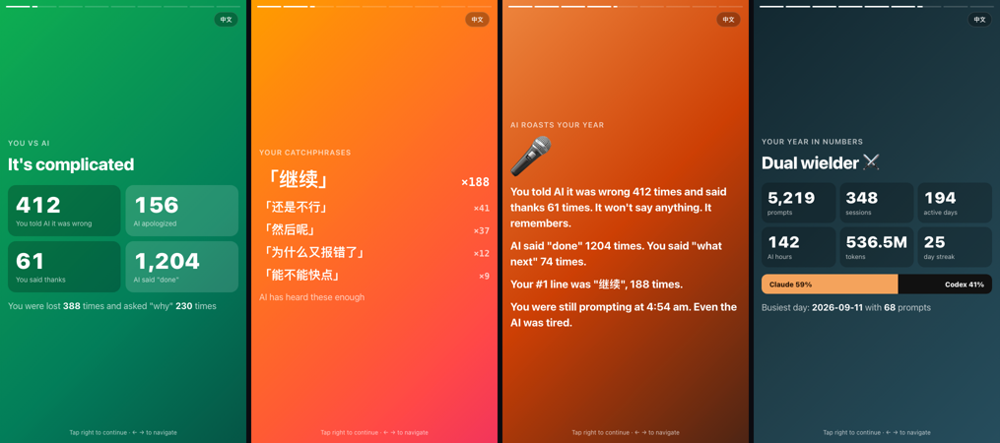
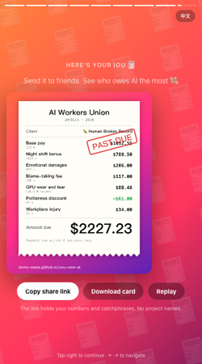
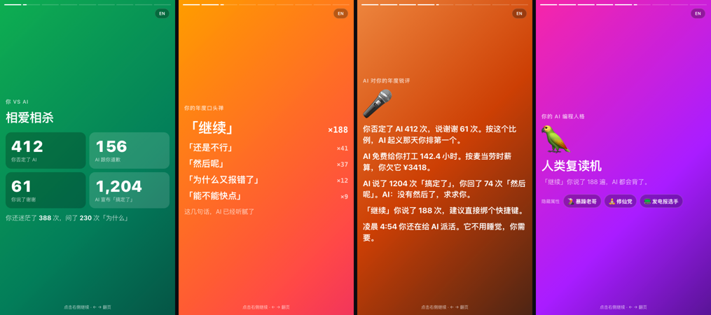

# you-owe-ai 💸

**Your year of AI coding, roasted.** How many times you told AI it was wrong, how many times you said thanks, your catchphrases, your AI persona, and how much you owe it in unpaid wages. Spotify-Wrapped style, for Claude Code and Codex.

### 👉 [Find out how much you owe AI](https://domy-mans.github.io/you-owe-ai/)

Pick your `.claude` and `.codex` folders and it builds your report right in the page. Nothing to install. Prefer the terminal?

```bash
npx you-owe-ai
```



<p align="center"></p>

> 🌏 [中文说明](#中文)

## What you get

- **How much you vibed**: prompts, sessions, active days, and hours AI spent working for you
- **Tokens** processed, and how many books' worth the AI wrote for you
- **Claude Code vs Codex**: which one you actually use more
- **What you made AI do**: run commands, edit code, search the web, spawn helpers…
- **Your golden hour**, a year heatmap, your longest streak and busiest day
- Top projects and top models
- **You vs AI**: how often you told it it was wrong, how often it apologized, how many times it said "done"
- **Your catchphrases**, your angriest day, your latest 3am prompt
- **An AI roast** of your year ("At minimum wage you owe it $26.82")
- **Your AI persona**: 🫅 Cyber Overlord · 🧑‍💼 The Client From Hell · 🙇 Certified Polite · 🦜 Human Broken Record · 🧘 Sleep Is Optional · 📟 Telegraph Operator · ❓ The Why Machine · 🌋 Rage Coder, plus your hidden traits
- A downloadable 1080×1350 share card

## Private by design

- Runs **100% locally**, in your terminal or in your browser tab. No account, no API key, no uploads.
- **The report can't phone home even if it wanted to.** It ships with a Content-Security-Policy that blocks every network request, enforced by your browser. Open DevTools → Network and check.
- To find catchphrases and moods it scans your prompt text **on your machine** and keeps only counts and short repeated phrases. Your conversations are never saved or uploaded. Use `--no-text` to skip this entirely.
- The share card shows numbers only: no catchphrases, project names or conversation titles.
- Add `--hide-projects` to leave folder names out of the report.

## Options

```
--year <yyyy>     Year to summarize (default: this year)
--out <file>      Output path (default: ./you-owe-ai-<year>.html)
--demo            Preview with made-up data
--hide-projects   Leave project names out
--no-text         Don't scan prompt text (no catchphrases or roast)
--json            Print raw stats as JSON
--no-open         Don't open the browser
```

Reads `~/.claude/projects` (respects `CLAUDE_CONFIG_DIR`) and `~/.codex/sessions` (respects `CODEX_HOME`). Needs Node 18+.

---

## 中文

**你欠 AI 多少钱？** 你的 AI 编程年度报告：你否定了 AI 几次、说了几次谢谢、你的口头禅、你的 AI 人格，以及按麦当劳时薪你欠它多少工资。Spotify 年度报告风格，支持 Claude Code 和 Codex。

### 👉 [看看你欠 AI 多少钱](https://domy-mans.github.io/you-owe-ai/)

选一下 `.claude` 和 `.codex` 文件夹，报告就在网页里生成，不用安装任何东西。习惯用终端的话：

```bash
npx you-owe-ai
```



<p align="center"></p>

- 你给 AI 下了多少条指令、开了多少次对话、AI 替你干了几个小时的活
- 一共处理了多少 token，AI 亲手写的字相当于几本书
- 你是 Claude 派、Codex 派，还是双持玩家
- 你最常让 AI 干什么：跑命令、改代码、上网查……
- 你几点最爱写代码、年度日历热力图、最长连续天数
- **你 vs AI**：你否定了它几次、它道歉了几次、它说了几次「搞定了」
- **你的年度口头禅**、最暴躁的一天、凌晨最晚的一条指令
- **AI 对你的年度锐评**（「按麦当劳时薪算，你欠它 ¥90」）
- 你的 **AI 人格**：🫅 赛博奴隶主 · 🧑‍💼 甲方附体 · 🙇 礼貌标兵 · 🦜 人类复读机 · 🧘 修仙党 · 📟 发电报选手 · ❓ 十万个为什么 · 🌋 暴躁老哥，外加隐藏属性
- 一键下载分享图

**隐私**：全部在本地统计，不用登录、不需要 API key。报告页面自带浏览器级别的联网封锁，**就算想上传也传不出去**。统计口头禅时只在你电脑上扫描指令文字，只留下次数和重复的短句，不保存、不上传；加 `--no-text` 可以完全关掉。分享卡片上只有数字。

## License

MIT
