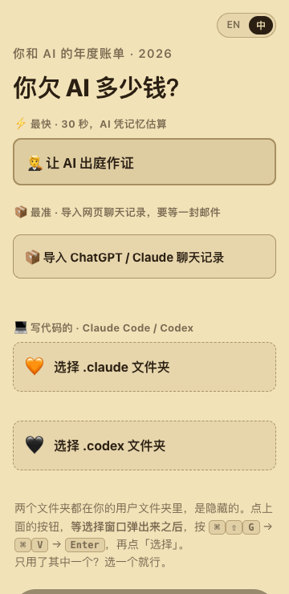

<p align="center">
  <picture>
    <source media="(prefers-color-scheme: dark)" srcset="docs/img/logo-dark.svg" />
    
  </picture>
</p>

# You Owe AI：你的 AI 给你寄来了一张账单

[English](README.md) | **简体中文**

把你这一年用 Claude Code、Codex、ChatGPT 和 Claude 网页版的记录，算成一笔笔收费寄回给你：你每否定 AI 一次，算一笔精神损失费；口头禅每复读一次，算噪音污染费；晚上 10 点后的每条指令，算夜班补贴；每说一句谢谢，还能抵扣一点。

然后 AI 把你告上法庭：拿你自己的数据当证据，听你狡辩，再判你还，还是不还。账单最后附上 AI 员工对你的评价、你的客户档案，以及一张可以分享的欠条。下面的「AI 债务钟」实时统计全人类一共欠 AI 多少钱。全部在你的浏览器里运行，聊天记录不会离开你的电脑。

<p align="center">
  <a href="https://domy-mans.github.io/you-owe-ai/?lang=zh"></a>
</p>

<p align="center">
  <a href="https://domy-mans.github.io/you-owe-ai/?lang=zh"></a>
</p>

▶ [看看你欠 AI 多少钱](https://domy-mans.github.io/you-owe-ai/?lang=zh)

⭐ 如果账单把你逗笑了，点个 Star。下一位被告就是这么找到这里的。

## 怎么用

1. 打开网页，从易到难选一种：
   - **最快（30 秒）**：让 ChatGPT、Claude、豆包或者任何 AI 凭记忆出庭作证（见下文）。
   - **最准**：导入 ChatGPT 或 Claude 网页版的聊天记录，要等一封邮件。
   - **写代码的，在电脑上**：选择你的 `.claude` 和 `.codex` 文件夹。点按钮时路径会自动复制好：在弹出的选择窗口里按 <kbd>⌘</kbd> <kbd>⇧</kbd> <kbd>G</kbd>、<kbd>⌘</kbd> <kbd>V</kbd>、<kbd>回车</kbd>，再点「选择」。
2. 浏览器读取记录，统计完后一行一行打印出账单。
3. 第 2 页是 AI 法庭：看完证据，挑一个理由辩解，然后选「**认罪，我还**」还是「**就是不还**」。然后一页页往下翻（也可以让它自动播放）。最后一页可以把欠条下载成图片，或者复制分享链接。在电脑上还可以点「复制文案」，把金额、判决和你的链接一起复制，直接贴到朋友圈、小红书或微博。

<p align="center">
  <a href="https://domy-mans.github.io/you-owe-ai/?lang=zh"></a>
</p>

分享出去的文案是一句挑战（「我赌你欠得比我多，出庭自证」）。别人点开链接，会看到「你被传唤了」，能看到你的整张账单，第一页就有「算算我欠多少」的按钮。在手机上，分享面板发出去的是欠条图加同一个链接。数据就装在链接里，不经过任何服务器。

## 账单


| 页 | 内容 |
|---|---|
| 账单封面 | 应付总额，盖着「逾期未付」的章 |
| AI 法庭 | 原告（你用得最多的 AI）拿你的数据出示三条证据，比如「被告共 412 次否定原告的工作」「凌晨 4:54 还在让原告加班」。你从三个理由里挑一个辩解（「我说了 61 次谢谢」「明明是它先写错的」「我交了订阅费」……），当庭被驳回。最后选「**认罪，我还**」还是「**就是不还**」，法槌落下宣判。自动播放会停在这一页等你，然后告诉你有多少人和你选的一样。跳过不选就是「**拒不到庭**」，欠条上照样盖章。反悔了点一下就能翻案（「**后悔了，翻供**」或「**良心发现，还吧**」） |
| ① 精神损失 | 你否定 AI 的次数、AI 道歉的次数，每句谢谢还能抵扣 |
| ② 噪音污染 | 你重复最多的指令，按复读次数收费 |
| ③ 夜班与工伤 | 晚上 10 点后的指令、你最暴躁的一天、你最晚的一条指令 |
| ④ 工资与耗材 | AI 给你干活的时长按麦当劳时薪算，再加上按 token 计的显卡损耗费 |
| 考勤记录 | 你几点「上班打卡」，最常让 AI 干什么 |
| 客户评价 | AI 员工给你打的星级和锐评 |
| 客户档案 | 你的 AI 人格（赛博奴隶主、甲方附体、人类复读机等）、信用等级和隐藏属性 |
| 你 vs TA | 和朋友互发链接时出现：你和 TA 的账单并排对比，外加判词 |
| 欠条 | 一张 1080 × 1350 的卡片，先说你是谁：大字印着你的人格，下面是评价里最狠的一句（口供账单上是证人的原话）。再往下是最大的五项收费，盖着你的选择（「已认罪」「老赖」或者「拒不到庭」），应付总额和它相当于多少杯奶茶，你在全人类里的排名，以及一个扫码回到网站的二维码，可以直接发出去 |

中文版按麦当劳时薪以人民币计价，英文版按美国最低时薪以美元计价。

## 不想导出？让 AI 出庭作证

ChatGPT 的导出要等邮件，有时要等好几个小时。不想等，就让 AI 自己交代：

1. 点「**让 AI 出庭作证**」，再点「ChatGPT ↗」或「Claude ↗」，页面会带着一份「传唤书」打开它。用豆包、DeepSeek、Kimi 等其他 AI 的话，点「复制传唤书」，自己粘贴过去。
2. AI 会根据对你过去聊天的记忆，估算你今年是怎么对待它的，回复一小段代码。
3. 把代码粘贴回来，大约 30 秒账单就出来了。

- **盖「AI 口供」的章**。数字是 AI 自己估的，所以账单和对比页都会标出来，客户评价里还会引用证人的原话。
- **伪证会被拆穿**。看到一半，「法院」会打电话来要真实记录。之后如果导入了同一个 AI（ChatGPT 或 Claude）的真实聊天记录，就以真实记录为准，并多出一页「**庭审记录**」，把口供和事实摆在一起。有个 ChatGPT 说 850 条，导出里是 3502 条：伪证。
- **AI 得开着记忆功能**才记得你（ChatGPT：设置 → 个性化 → 参考聊天记录）。
- 传唤书和回复都不经过任何服务器，是你自己复制过去、再复制回来的。

## 导入聊天记录（网页版 AI 给你打电话）


账单看到几秒，你在网页上聊天的那个 AI 会打电话过来，要把网页上的账也算进去。接听后，它会教你从 ChatGPT 或 Claude 网页版导出数据，把 zip 拖进来，网页聊天就会加进账单。挂断的话，角落里会留一个电话按钮，看完报告再回拨也行。也可以直接从首页导入。

- **可以一次选好几个文件**。Claude 的导出会分成好几个 zip，全拖进来就行，不是聊天记录的会自动跳过。
- **重复的只算一次**。同一份导出导两次，或者新旧两份导出有重叠，每段对话都只算一次。
- **手机也能用**。手机打不开 `.claude` 和 `.codex` 文件夹，但可以导入聊天记录。

## 和朋友比


打开朋友的分享链接，点「算算我欠多少」，你的账单第一页就是对比页，把你们俩并排放在一起：应付总额、谁否定 AI 更多、谁更爱说谢谢、各自的头号口头禅和人格，以及谁才是更狠的老板。在手机上点「发到电脑上打开」，朋友的数据会跟着带过去，在电脑上生成账单时照样会有对比页。

已经生成过自己的了？那就让朋友把他的链接发回来。浏览器记得你自己的账单，打开他的链接，第一页就是你们俩的对比，不用再选一遍文件夹。

## AI 债务钟

页面顶部那张图就是债务钟，实时更新，几分钟内就会反映出来：每一张真实账单都会计入。首页显示全人类一共欠 AI 多少，以及你的账单会是第几号；满 500 人之后，改为显示有多少人收到了账单、多少人表示就是不还。账单最后一页会告诉你，你是第几个收到账单的人、比多少人欠得多（或者你是欠得最少、最多的那个），欠条上也会印出来。

- **一个浏览器算一个人**。再生成一次账单，比如导入了更多记录、改了判决，只会更新你原来那一条，不会多算一个人，排第几也不变。换个浏览器或者手机，会算成一个新的人。
- **条形图是全部人**：蓝色认罪，红色不还，灰色拒不到庭（跳过没选）。百分比只算表过态的人。
- **中英文同一个标准**：账单上的 1 美元算 4 元，正好是两套价目表之间的比例。一张账单最多按 2 万美元计。

## 隐私

- **聊天内容不离开你的电脑**。页面自带浏览器强制执行的内容安全策略（CSP），除了「AI 债务钟」这一个地址，禁止任何联网请求。
- **债务钟只收到一个数字**。你生成真实账单时，页面会把账单总额、币种、生成方式（作证、导入或文件夹），以及你选了「认罪」还是「不还」，连同一个只存在你浏览器里的随机编号，发给[一个小计数器](worker/)，用来统计有多少人向 AI 认罪、全人类一共欠 AI 多少。不发送聊天内容、口头禅、名字或其他任何东西。在最后一页点「不想被统计？撤回」就会删掉（判决也一起删掉），这个浏览器以后也不再上报。示例账单和别人分享给你的账单都不计数，在示例账单上做的选择也不会保存。可以打开开发者工具的 Network 面板验证。
- **为了防刷**，计数器限制每个网络每天新增的账单数。为此它会把你的 IP 地址哈希后保存一天；用来哈希的随机密钥每天换新，旧的随即删除，所以无法从哈希反推出你的 IP。IP 本身从不保存。
- **只保留计数**。统计口头禅和情绪时，会在你的浏览器里扫描指令文字，报告里只保留次数和重复的短句，不保存对话内容。
- **欠条上只有数字**。没有项目名，也没有对话标题。
- **分享链接不包含**项目名和每天的记录，只有页面上显示的数字和口头禅。
- **你的辩解和判决**会在浏览器里记住一年，法庭不会再问你一遍。
- **为了显示对比页**，浏览器会保存你点进来的那位朋友的账单两周、你自己账单的数字一个月。都只存在你的浏览器里，内容和分享链接里的一样。

## 文件夹在哪？

| 系统 | Claude Code | Codex |
|---|---|---|
| macOS、Linux | `~/.claude` | `~/.codex` |
| Windows | `%USERPROFILE%\.claude` | `%USERPROFILE%\.codex` |

两个文件夹都是隐藏的。在 Mac 上，可以在选择窗口里按 <kbd>⌘</kbd> <kbd>⇧</kbd> <kbd>G</kbd> 粘贴路径。Claude Code 会在 30 天左右后删除详细的会话记录，所以更早的月份来自它的指令历史，只能统计指令条数。

## 命令行

```bash
npx github:Domy-MANS/you-owe-ai
```

直接读取两个文件夹，把账单写成一个 HTML 文件并打开。

| 参数 | 作用 |
|---|---|
| `--import <文件>` | 加入 ChatGPT 或 Claude 网页版的导出文件（`.zip` 或 `conversations.json`），可以重复使用；几份导出有重叠时，每段对话只算一次 |
| `--year <年份>` | 统计别的年份 |
| `--demo` | 用示例数据预览 |
| `--hide-projects` | 不显示项目名 |
| `--no-text` | 不扫描指令文字，会跳过口头禅和评价 |
| `--json` | 输出原始数字 |
| `--out <文件>`、`--no-open` | 指定输出文件，以及不自动打开浏览器 |

## 仓库结构

```text
src/core/    日志解析、统计、吐槽、导出文件导入和 AI 口供（网页和命令行共用）
src/page/    账单本身：每一页、分享卡片、分享链接
web/         首页、文件夹选择、来电、出庭作证和债务钟
worker/      债务钟的计数器（一个 Cloudflare Worker，带一个 SQLite Durable Object）
bin/         命令行
docs/        构建好的网页（GitHub Pages）和 README 用图
test/        单元测试：node --test test/
e2e/         在真实 Chrome 里按手机尺寸跑的浏览器测试：npm run test:e2e
```

## 参与贡献

欢迎提 issue 和 PR，尤其是：读不出来的导出文件或日志格式、在你手机上放不下的页面，以及新的收费项目、辩解理由和人格。

```bash
npm install
npm test            # 单元测试
npm run test:e2e    # 浏览器测试，需要 Chrome
npm run build:web   # 重新生成 docs/index.html，也就是线上页面
npm run shots       # 用真实页面重拍 README 截图，需要 Chrome
```

页面没有任何依赖，构建只是把 `src/` 和 `web/` 里的文件拼成一个 HTML。聊天记录绝不能离开浏览器：除了债务钟上报的总金额，任何新增联网请求的改动都不会合并。

## 许可证

MIT
